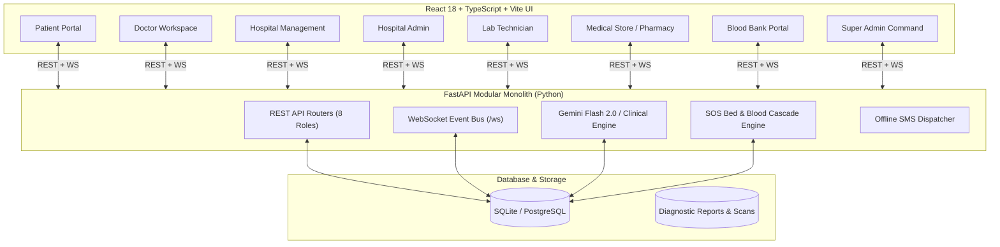

# 🏥 ArogyaFlow (ఆరోగ్యఫ్లో)
### Integrated Healthcare, Emergency Triage & Resource Management Platform
> **Architecture**: Modular Monolith with an Event-Driven WebSocket Layer  
> **Tech Stack**: Python (FastAPI + WebSockets + SQLAlchemy) • React 18 (TypeScript + Vite + Tailwind CSS) • PostgreSQL / SQLite • Google Gemini Flash AI • Google In-Built Web Speech

---

## 📑 Table of Contents
1. [Platform Overview & Architecture](#-platform-overview--architecture)
2. [Complete Features & Core Workflows](#-complete-features--core-workflows)
   - [1. Google Voice-to-Type & Spoken Doctor Reply (Multilingual AI Triage)](#1-google-voice-to-type--spoken-doctor-reply-multilingual-ai-triage)
   - [2. Multi-City Medicine Finder & Stock Inspector](#2-multi-city-medicine-finder--stock-inspector)
   - [3. Gemini 2.0 Flash Free Tier AI & Offline Clinical Engine](#3-gemini-20-flash-free-tier-ai--offline-clinical-engine)
   - [4. One-Tap Emergency SOS Pre-Arrival Chain Reaction](#4-one-tap-emergency-sos-pre-arrival-chain-reaction)
   - [5. Attendance-to-Discovery Re-routing (Absent Doctor Hiding)](#5-attendance-to-discovery-re-routing-absent-doctor-hiding)
   - [6. Generic Medicine Replacement & Multi-Pharmacy Price Comparison](#6-generic-medicine-replacement--multi-pharmacy-price-comparison)
   - [7. Smart Medicine Strip Analyzer (Nameless / Cut Strips)](#7-smart-medicine-strip-analyzer-nameless--cut-strips)
   - [8. Refill Tracker & Early Store Closing Offline SMS Dispatch](#8-refill-tracker--early-store-closing-offline-sms-dispatch)
   - [9. Diagnostic Lab Scan Upload & Dual-Sync](#9-diagnostic-lab-scan-upload--dual-sync)
   - [10. Regional Disaster Warning & Inter-Hospital Evacuation Transfer](#10-regional-disaster-warning--inter-hospital-evacuation-transfer)
3. [8-Role RBAC System & Seeded Demo Accounts](#-8-role-rbac-system--seeded-demo-accounts)
4. [Step-by-Step Interactive Demo Walkthrough](#-step-by-step-interactive-demo-walkthrough)
5. [How to Run Locally](#-how-to-run-locally)
6. [Automated Verification & Testing](#-automated-verification--testing)
7. [Production Deployment Guide](#-production-deployment-guide)

---

## 🏛️ Platform Overview & Architecture

ArogyaFlow resolves the critical cross-portal disconnects that cause mortality, emergency delays, and medical black markets in public healthcare systems.

Instead of building fragmented microservices that slow down development and desynchronize state, ArogyaFlow uses a **Modular Monolith with an Event-Driven WebSocket Layer**:
* **Unified Database Transactions**: Immediate ACID guarantees linking UHID Consent Tokens, Hospital Staff Attendance, Emergency Bed Locks, and Pharmacy Salt Mapping.
* **Reactive Real-Time Event Bus (`/ws`)**: WebSockets instantly push sirens, bed allocations, doctor attendance flips, and generic drug approvals across screens without page reloads.
* **Strict Role-Based Access Control (RBAC)**: 8 distinct portal experiences driven by JWT claims (`role`, `org_id`, `uhid`).
* **Unified Static SPA Serving**: In production, the FastAPI server serves both the REST APIs, WebSockets, and the compiled React SPA from a single port, eliminating CORS issues and hosting overhead.



---

## 🌟 Complete Features & Core Workflows

### 1. Google Voice-to-Type & Spoken Doctor Reply (Multilingual AI Triage)
* **Google In-Built Voice to Text**: Integrated directly with the browser's native **Web Speech API** (`webkitSpeechRecognition`), powered by Google's native speech recognition in Chrome, Edge, and Android.
* **Auto-Detect or Manual Language Selection**:
  * 🌐 **Auto-Detect Language** (automatically distinguishes Telugu `\u0c00-\u0c7f`, Devanagari/Hindi `\u0900-\u097f`, Tamil, Kannada, and English).
  * 🇮🇳 **Telugu (తెలుగు)** (`te-IN`)
  * 🇮🇳 **Hindi (हिंदी)** (`hi-IN`)
  * 🇮🇳 **Indian English** (`en-IN`)
  * 🇮🇳 **Tamil (தமிழ்)** (`ta-IN`)
  * 🇮🇳 **Kannada (ಕನ್ನಡ)** (`kn-IN`)
* **Real-time Live Transcribe**: Pulsing red recording button (`🔴 Listening in [Language]... Speak now`) with animated audio waves streams spoken words directly into the symptom text box.
* **Spoken Voice Reply (Text-to-Speech)**: The AI generates a conversational voice reply written in that exact language. The patient can click **`🔊 Listen to Advice (వినండి / सुनिए)`** to hear the assessment spoken aloud via `SpeechSynthesisUtterance`.
* **Auto-Speak Toggle**: Check `Auto-speak Doctor's voice reply in patient's language` to automatically play audio as soon as triage finishes.

### 2. Multi-City Medicine Finder & Stock Inspector
* **City-Based Inventory Filtering**: Search live pharmacy stock across **Visakhapatnam**, **Vijayawada**, and **Guntur** (or view *All Cities*).
* **Search by Brand Name or Generic Salt**: Search `Dolo 650`, `Augmentin`, `Paracetamol`, `Metformin`, `Pantoprazole`, or `Azithromycin`.
* **Live Price & Best-Price Highlighting**: Dynamically ranks medicines with a prominent green **Best Price** badge on the most affordable option.
* **Real-Time Stock Badges**: Color-coded badges indicating `IN STOCK` (with live unit count), `LOW STOCK`, or `OUT OF STOCK`.
* **Expiry Dates & Daily Closing Hours**: Displays batch expiry date (e.g., `2026-08-31`) and store closing time (e.g., `Closes at 22:30` or `24 Hours Open`).
* **Reserve Dose Button**: Allows the patient to reserve 1 unit for same-day pickup before closing time with instant confirmation toast alerts.

### 3. Gemini 2.0 Flash Free Tier AI & Offline Clinical Engine
* **Google Gemini AI Microservice**: Supports **Gemini 2.0 Flash** and **Gemini 1.5 Flash** (Google AI Studio's 100% free rate-limited tier, zero credit card required).
* **Built-in Offline Clinical Intelligence Fallback**: If no Gemini API key is provided, the platform automatically switches to its deterministic clinical engine, providing medical triage, severity classification, specialist routing, and native voice audio in Telugu, Hindi, and English with zero external dependencies.

### 4. One-Tap Emergency SOS Pre-Arrival Chain Reaction
* **Zero Manual Steps**: Pressing the red SOS button bundles live GPS coordinates, patient blood group (`O-ve`), and medical vault history.
* **ICU Bed Lock & Cascade**:
  1. Checks the nearest Multi-Specialty Hospital (Hospital A). If ICU beds = 0, automatically cascades to the 2nd nearest hospital (Hospital B).
  2. Instantly locks 1 ICU Trauma Bed at Hospital B.
* **Pre-Arrival Blood Escalation**:
  1. Checks hospital internal blood stock for the patient's blood type.
  2. If internal units = 0, automatically escalates to external blood banks (e.g., Rotary Blood Bank) and reserves 1 live unit.
  3. If external blood bank units are also 0, automatically triggers emergency donor outreach to registered local volunteer donors.
* **Live Siren Alert**: Hospital Management and Blood Bank portals receive high-priority WebSocket alerts with audio sirens and emergency UHID tokens.

### 5. Attendance-to-Discovery Re-routing (Absent Doctor Hiding)
* **Hospital Admin Attendance Flip**: Hospital Admin toggles a doctor's attendance from `Present` to `Absent`.
* **Public Discovery Hiding**: That doctor immediately disappears from the Patient Hospital Discovery "Table" filter in real time.
* **Auto-Reassignment Pipeline**:
  1. Any appointments already scheduled with that doctor for today are automatically flagged with `RESCHEDULE_REQUIRED`.
  2. Hospital Management receives an instant high-priority WebSocket alert.
  3. Hospital Management reassigns affected patients to another available specialist with 1 click.

### 6. Generic Medicine Replacement & Multi-Pharmacy Price Comparison
* **Doctor Generic Approval**: Doctor prescribes a branded drug (e.g., *Augmentin 625*). The patient requests a generic alternative in 1 click.
* **Doctor Approval**: The attending doctor reviews and approves the generic substitute (`Amoxicillin + Clavulanic Acid 625mg`).
* **Multi-Pharmacy Price Comparison Table**: Unlocks a real-time price comparison across all registered medical stores (e.g., Jan Aushadhi Kendra ₹65 vs. Sanjeevani MedPlus ₹180 vs. Apollo Pharmacy ₹195), saving patients up to 70% on essential medicines.

### 7. Smart Medicine Strip Analyzer (Nameless / Cut Strips)
* **Tier 1 (OCR Text & Salt Match)**: Analyzes camera text fragments and imprints against the national drug formulary.
* **Tier 2 (Cut/Torn Strip Cross-Referencing)**: If the strip is torn, cut, or nameless, the engine cross-references partial text with the patient's own past prescription history on file to safely identify remaining doses and dosage instructions.

### 8. Refill Tracker & Early Store Closing Offline SMS Dispatch
* **Dosage Countdown**: Tracks daily doses and flags medications with $\le 3$ days of remaining doses.
* **Disaster / Early Closing SMS**: When pharmacies broadcast early closure (e.g., cyclone warnings or curfew), automated offline SMS alerts are dispatched to high-risk chronic patients reminding them to refill before stores close.

### 9. Diagnostic Lab Scan Upload & Dual-Sync
* **Doctor Order**: Doctor creates a diagnostic order (e.g., Chest X-Ray, CT Scan, Cardiac Biomarkers).
* **Lab Tech Worklist**: Order appears immediately on the Lab Technician's diagnostic worklist.
* **AI Summary & Dual-Sync**: Lab Tech uploads the scan and findings. The Gemini AI engine generates a patient-friendly summary in Telugu, Hindi, or English, and synchronously publishes the report to both the Doctor's Clinical Workspace and the Patient's Vault.

### 10. Regional Disaster Warning & Inter-Hospital Evacuation Transfer
* **Super Admin Alert**: Super Admin broadcasts a regional disaster warning (e.g., *Coastal Red Zone Cyclone Alert*).
* **Inter-Hospital Record Cloning**: Hospital Management evacuates high-risk patients from a Danger Zone hospital (Hospital A) to a Safe Zone hospital (Hospital B). All clinical notes, vitals, and diagnostic scans are securely transferred with a new 7-day UHID consent token.

---

## 👥 8-Role RBAC System & Seeded Demo Accounts

> **Universal Password for all accounts**: `pass123`  
> *(You can also switch between any account in **1 click** using the **"Quick Demo Login"** dropdown in the top navigation bar!)*

### 1. Super Admin
| Name | Role | Email | Organization |
| :--- | :--- | :--- | :--- |
| Dr. K. Somasekhar | `SUPER_ADMIN` | `superadmin@arogyaflow.gov.in` | National Health Authority Command |

### 2. Hospital A (Ramnagar, Visakhapatnam — Danger Zone, 0 ICU Beds, 0 O-ve Blood)
| Name | Role | Email | Department / Position |
| :--- | :--- | :--- | :--- |
| V. S. Murthy | `HOSP_ADMIN` | `admin.hospa@arogyaflow.gov.in` | Hospital Administrator (Apollo Speciality) |
| Sravani Rao | `HOSP_MGMT` | `mgmt1.hospa@arogyaflow.gov.in` | Triage & Bed Management |
| Dr. Rajesh Varma | `DOCTOR` | `dr.rajesh@apollo.arogyaflow.in` | Cardiology (Default: Present) |
| Dr. Sneha Reddy | `DOCTOR` | `dr.sneha@apollo.arogyaflow.in` | Neurology (Default: Absent) |
| Dr. Vikram Rao | `DOCTOR` | `dr.vikram@apollo.arogyaflow.in` | General Medicine (Default: Present) |
| Dr. Priya Nair | `DOCTOR` | `dr.priya@apollo.arogyaflow.in` | Orthopedics (Default: Present) |
| G. Praveen | `LAB_TECH` | `lab1.hospa@arogyaflow.gov.in` | Senior Radiographer & Lab Incharge |

### 3. Hospital B (Maharanipeta, Visakhapatnam — Safe Zone, 10 ICU Beds)
| Name | Role | Email | Department / Position |
| :--- | :--- | :--- | :--- |
| T. Chandrasekhar | `HOSP_ADMIN` | `admin.hospb@arogyaflow.gov.in` | Hospital Administrator (Care Super Speciality) |
| Madhavi Latha | `HOSP_MGMT` | `mgmt.hospb@arogyaflow.gov.in` | Safe Zone Bed Allocation Incharge |
| Dr. Arvind Swamy | `DOCTOR` | `dr.arvind@care.arogyaflow.in` | Critical Care & Pulmonology |
| M. Kalyani | `LAB_TECH` | `lab1.hospb@arogyaflow.gov.in` | Diagnostic Pathologist |

### 4. Hospital C (Seethammadhara — Local Primary Care Clinic)
| Name | Role | Email | Department / Position |
| :--- | :--- | :--- | :--- |
| Dr. B. Ramana | `DOCTOR` | `dr.ramana@clinic.arogyaflow.in` | Primary Care Physician (Local Clinic) |

### 5. Multi-City Medical Stores / Pharmacies
| Store Name | Role | Email | City | Operating Hours |
| :--- | :--- | :--- | :--- | :--- |
| **Sanjeevani MedPlus** | `PHARMACY` | `pharmacy@medplus.com` | Visakhapatnam | Closes at 22:30 |
| **Apollo Pharmacy** | `PHARMACY` | `pharmacy@apollopharmacy.com` | Visakhapatnam | 24 Hours Open |
| **Jan Aushadhi Kendra** | `PHARMACY` | `pharmacy@janaushadhi.gov.in` | Visakhapatnam | Closes at 20:00 (Lowest Generic Price) |
| **Sri Balaji Druggists** | `PHARMACY` | `pharmacy.balaji@vizagmed.in` | Visakhapatnam | Closes at 21:30 |
| **Amaravati Healthcare Chemist** | `PHARMACY` | `pharmacy@amaravatichems.in` | Vijayawada | Closes at 22:00 |
| **Krishna Valley Medico** | `PHARMACY` | `pharmacy@krishnamedico.in` | Vijayawada | Closes at 23:00 |
| **Spandana Pharma & Surgical** | `PHARMACY` | `pharmacy@spandanapharma.in` | Guntur | Closes at 21:00 |
| **Mirchi City Aushadhalaya** | `PHARMACY` | `pharmacy@mirchiaushadh.in` | Guntur | Closes at 20:30 |

### 6. Blood Banks
| Blood Bank Name | Role | Email | Location |
| :--- | :--- | :--- | :--- |
| **Rotary Blood Bank & Component Center** | `BLOOD_BANK` | `rotary.bb@arogyaflow.gov.in` | Visakhapatnam Hub |
| **Red Cross Society Blood Center** | `BLOOD_BANK` | `redcross.bb@arogyaflow.gov.in` | Beach Road Center |

### 7. Patients
| Name | UHID | Blood Group | Email | Profile Focus |
| :--- | :--- | :--- | :--- | :--- |
| **Kiran Kumar** | `UHID-908123` | `O-ve` | `patient1@arogyaflow.gov.in` | Trauma accident profile (Emergency SOS testing) |
| **Lakshmi Devi** | `UHID-456781` | `B+ve` | `patient2@arogyaflow.gov.in` | Chronic diabetic profile (2 days doses left for Refill alert) |
| **Venkatesh Rao** | `UHID-112233` | `A+ve` | `patient3@arogyaflow.gov.in` | Booked with absent doctor today (Reschedule alert) |
| **Ananya Sharma** | `UHID-445566` | `AB+ve` | `patient4@arogyaflow.gov.in` | Booked with absent doctor today (Reschedule alert) |
| **Suresh Babu** | `UHID-312984` | `B-ve` | `patient.suresh@arogyaflow.gov.in` | Vijayawada resident (Medicine Finder by City) |
| **Anuradha Rao** | `UHID-671234` | `O+ve` | `patient.anuradha@arogyaflow.gov.in` | Guntur resident (Chronic hypertension) |

---

## 🎮 Step-by-Step Interactive Demo Walkthrough

### Scenario 1: Voice-to-Type & Spoken Doctor Reply (Telugu / Hindi)
1. In the top navigation bar, select **Kiran Kumar (Patient)** from the Quick Demo Switcher.
2. Click the **Multilingual AI Triage** tab.
3. Test speech recognition:
   * Click **`🎙️ Voice to Type (Google Voice-to-Text)`** and speak your symptoms into your microphone.
   * *OR* click the one-click Telugu test chip: `🇮🇳 గుండె నొప్పి (Telugu)`.
4. Click **Run Multilingual AI Triage (AI విశ్లేషణ)**.
5. The result card displays:
   * **Severity: CRITICAL** $\rightarrow$ Recommended Tier: **MULTI_SPECIALTY**
   * **🔊 Spoken Doctor's Voice Advice (తెలుగు)**: *"ఇది అత్యవసర పరిస్థితి. దయచేసి వెంటనే మల్టీ-స్పెషాలిటీ ఆసుపత్రికి వెళ్లండి లేదా అత్యవసర SOS నొక్కండి."*
   * Click **`🔊 Listen to Advice (వినండి / सुनिए)`** to hear the audio spoken aloud.

### Scenario 2: Search Medicine Availability & Price by City
1. Still in the Patient portal, click the **Medicine Finder by City** tab.
2. Select **Vijayawada** or **Guntur** from the city dropdown.
3. Type `Dolo` or click the `Dolo 650` chip.
4. Compare store prices, stock counts, and daily closing times across pharmacies.
5. Notice the green **Lowest Price** badge on the most affordable store.
6. Click **Reserve Dose** $\rightarrow$ Instant reservation confirmation alert is displayed.

### Scenario 3: One-Tap Emergency SOS Bed Lock & Blood Escalation
1. In the Patient portal header, click the red **ONE-TAP EMERGENCY SOS** button.
2. The system executes zero manual steps:
   * Hospital A has **0 ICU beds** $\rightarrow$ Diverts to **Care Super Speciality (Hospital B)**.
   * **1 ICU Trauma Bed** is locked at Hospital B.
   * Patient has `O-ve` blood and Hospital B has 0 units $\rightarrow$ Automatically escalates to **Rotary Blood Bank** and reserves 1 unit before the ambulance arrives.
3. Switch to **Sravani Rao (Hospital Management)** in the role switcher to view the incoming live siren alert and patient chart.
4. Switch to **Rotary Blood Bank** to view the auto-reserved blood unit order.

### Scenario 4: Absent Doctor Hiding & Auto-Reassignment
1. Switch to **V. S. Murthy (Hospital Admin A)**.
2. In the Doctor Attendance Roster, find **Dr. Rajesh Varma (Cardiology)** and click **Mark Absent**.
3. Switch to **Patient Portal** $\rightarrow$ Click **Hospital Discovery ("Table" Filter)**.
4. Notice Dr. Rajesh Varma is **immediately hidden** from available doctors!
5. Switch to **Hospital Management** $\rightarrow$ Notice a high-priority alert: *"Dr. Rajesh Varma is marked Absent. Flagged appointments require immediate reassignment."*
6. Click **Reassign** to reallocate the patient to an available specialist with 1 click.

### Scenario 5: Generic Medicine Replacement & Multi-Pharmacy Savings
1. Switch to **Dr. Rajesh Varma (Doctor)**.
2. In the Clinical Workspace, prescribe **Augmentin 625 Duo** (`Amoxicillin + Clavulanic Acid 625mg`) for patient Kiran Kumar.
3. Switch to **Patient Portal** $\rightarrow$ Click **Generic Price Comparison**.
4. Click **Request Generic Alternative** $\rightarrow$ Switch back to Doctor and click **Approve Generic**.
5. The Patient portal unlocks the Multi-Pharmacy Price Comparison Table ranking:
   * **Jan Aushadhi Kendra**: **₹65.00** *(Lowest Price - 64% cheaper)*
   * **Sanjeevani MedPlus**: ₹180.00
   * **Apollo Pharmacy**: ₹195.00

### Scenario 6: Cut-Strip Nameless Medicine Analyzer
1. In the Patient portal, click the **Medicine Strip Analyzer** tab.
2. Enter a torn fragment (e.g., `Augmentin` or `Clavulanic`).
3. Click **Analyze Medicine**.
4. The system matches the chemical salt, flags whether it requires a doctor's prescription, and cross-references remaining doses against the patient's active prescriptions on record.

### Scenario 7: Diagnostic Lab Order & Dual-Sync
1. Switch to **Dr. Rajesh Varma (Doctor)** $\rightarrow$ In the Diagnostic Orders section, order a **Chest X-Ray (AP View)**.
2. Switch to **G. Praveen (Lab Technician)** $\rightarrow$ The pending order appears on the worklist.
3. Click **Upload Scan & Complete** $\rightarrow$ The scan is processed with Gemini AI summarization.
4. Switch to **Doctor Workspace** $\rightarrow$ The scan and clinical summary appear under the patient's record.
5. Switch to **Patient Portal** $\rightarrow$ Click **Reports & Scans Vault** to view the synced PDF scan and patient-friendly explanation.

### Scenario 8: Regional Disaster Alert & Evacuation Transfer
1. Switch to **Dr. K. Somasekhar (Super Admin)**.
2. Select **Cyclone Warning (Coastal Red Zone)** and click **Broadcast Regional Disaster Alert**.
3. All hospital dashboards receive an urgent disaster banner.
4. Patients with $\le 3$ days of chronic medicine doses receive automated offline SMS refill alerts.
5. Switch to **Hospital Management (Hospital A)** $\rightarrow$ Click **Evacuate to Safe Zone (Hospital B)** $\rightarrow$ The patient's clinical file and active UHID consent token are cloned to Hospital B in 1 click.

---

## 💻 How to Run Locally

### Prerequisites
* Python 3.10+
* Node.js 18+ and npm

### Option A: Unified Production Server (Simplest — 1 Command)
Builds the frontend and runs everything from a single FastAPI server:
```bash
# 1. Build the frontend
cd frontend
npm install
npm run build

# 2. Start the unified backend
cd ../backend
python3 -m venv venv
./venv/bin/pip install -r requirements.txt
./venv/bin/uvicorn main:app --host 0.0.0.0 --port 8000
```
Open **`http://localhost:8000`** in your browser.

---

### Option B: Development Mode (Hot Reloading)

#### 1. Start the FastAPI Backend
```bash
cd backend
python3 -m venv venv
./venv/bin/pip install -r requirements.txt
./venv/bin/uvicorn main:app --host 0.0.0.0 --port 8000 --reload
```
* **API Server**: `http://localhost:8000`
* **Interactive Swagger Docs**: `http://localhost:8000/docs`
* **WebSocket Endpoint**: `ws://localhost:8000/ws`

#### 2. Start the React Frontend
```bash
cd frontend
npm install
npm run dev
```
* **Web Application**: `http://localhost:5173`

---

## 🧪 Automated Verification & Testing

The repository includes comprehensive automated test suites for both backend workflows and browser interactions:

### 1. Automated Headless Browser Test Suite (Firefox)
Tests all 8 role dashboards, Voice-to-Type controls, Telugu audio synthesis, city filtering, and Emergency SOS in a real browser:
```bash
cd frontend
node browser_test.cjs
```
* **Results**: **47/47 tests passed (100% PASS)**
* **Screenshots Generated**: 14 full-page screenshots saved in [`frontend/screenshots/`](file:///home/tejasai/Documents/10l/frontend/screenshots/)

### 2. Backend End-to-End Workflow Test Suite (pytest/unittest)
Executes all 7 cross-portal clinical workflows in 3 seconds:
```bash
cd backend
./venv/bin/python test_e2e_workflows.py
```
* **Test 1**: RBAC login tokens across all 8 roles.
* **Test 2**: Hospital Admin attendance flip & public table hiding.
* **Test 3**: Patient AI Triage, UHID Consent Token generation & booking handoff.
* **Test 4**: Emergency SOS cascade routing, ICU bed lock & blood bank escalation.
* **Test 5**: Doctor lab order, lab tech upload & dual-sync.
* **Test 6**: Generic medicine replacement & 8-pharmacy comparison table.
* **Test 7**: Super Admin disaster alert, inter-hospital evacuation & offline SMS.
* **Results**: **7/7 tests passed (100% PASS)**

---

## 🚀 Production Deployment Guide

ArogyaFlow includes production-ready deployment configurations:

### Option 1: Render (100% Free Web Service)
Render uses the pre-configured [`render.yaml`](file:///home/tejasai/Documents/10l/render.yaml):
1. Push your repository to GitHub:
   ```bash
   git branch -M main
   git remote add origin https://github.com/<your-username>/arogyaflow.git
   git push -u origin main
   ```
2. Open [https://render.com/](https://render.com/) and click **New +** $\rightarrow$ **Web Service**.
3. Connect your repository. Render will automatically detect the [`Dockerfile`](file:///home/tejasai/Documents/10l/Dockerfile).
4. Set **Region** to *Singapore* (closest to India).
5. (Optional) Under **Environment Variables**, set `GEMINI_API_KEY`.
6. Click **Deploy Web Service** $\rightarrow$ Your app will be live with free SSL.

### Option 2: Railway (Fastest 1-Click Deploy)
Railway uses the pre-configured [`railway.json`](file:///home/tejasai/Documents/10l/railway.json):
1. Open [https://railway.app/](https://railway.app/) and click **New Project** $\rightarrow$ **Deploy from GitHub repo**.
2. Select your repository $\rightarrow$ Click **Deploy Now**.
3. Under **Settings** $\rightarrow$ **Networking**, click **Generate Domain**.
4. Your application will be live in under 2 minutes.

### Option 3: Any VPS / Linux Server with Docker Compose
To run on AWS EC2, DigitalOcean, or Hetzner:
```bash
git clone https://github.com/<your-username>/arogyaflow.git
cd arogyaflow
docker compose up -d --build
```
Verify the container health:
```bash
curl http://localhost:8000/api/health
```

---

## 📄 License & Attribution
Designed and built for public healthcare access, emergency triage transparency, and affordable medicine discovery across India.
